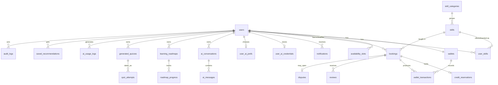

# SkillSwap — Architecture (Phase 1)

## 1. Principles
1. **Core never depends on AI.** Marketplace, bookings, wallet, video work with zero AI config.
2. **Money-like logic lives in one place** (`wallet_service.py`). Routes and AI code never touch balances.
3. **Server is the source of truth**: scores, room names, completion, balances are computed server-side.
4. **Thin routes, fat services.** Routes validate + call a service; services hold rules + transactions.
5. **One AI interface**, many providers; billing source is always explicit, never silently switched.

## 2. Layers
```
Browser (Bootstrap + JS)
   |  HTTPS, CSRF token
Flask blueprints (auth, skills, bookings, video, wallet, reviews, notifications, admin, ai, settings)
   |
Services (booking, wallet, matching, notification, ai/*)
   |
SQLAlchemy models  -->  MySQL 8 (InnoDB, utf8mb4)
   
External: Jitsi (iframe) | OpenAI | Ollama (localhost) | Hosted free provider (OpenAI-compatible)
```

## 3. Directory structure
See project tree. Blueprints own routes/forms/templates; `services/` owns business rules; `models/` owns schema only.

## 4. Database schema (22 tables)
Conventions: `id` BIGINT PK; `created_at/updated_at` UTC; money/credits = `DECIMAL(8,2)`; all FKs indexed.

| Table | Key columns / constraints |
|---|---|
| users | email UQ, username UQ, password_hash, role(user/admin), status(active/suspended), bio, location, avatar_path |
| skill_categories | name UQ |
| skills | category_id FK, name; UQ(category_id,name) |
| user_skills | user_id, skill_id, kind(offer/want), level, description, session_minutes, is_active, embedding JSON NULL |
| availability_slots | user_id, weekday 0-6, start_time, end_time (user's stored in UTC offset-free “local+tz” field `tz`) |
| bookings | learner_id, teacher_id, skill_id, start_utc, duration_min, status, room_id UQ, learner_confirmed, teacher_confirmed, credits Decimal; CHECK learner<>teacher |
| wallets | user_id UQ, available, reserved (CHECK >=0) |
| wallet_transactions | wallet_id, type(bonus/reserve/release/transfer_in/transfer_out), amount, booking_id NULL, idempotency_key **UQ** |
| credit_reservations | booking_id **UQ**, learner_id, amount, status(held/released/transferred) |
| reviews | booking_id, reviewer_id, reviewee_id, rating 1-5, comment; UQ(booking_id,reviewer_id) |
| disputes | booking_id UQ, opened_by, reason, status, resolved_by, resolution, resolved_at |
| notifications | user_id, type, message, link, is_read |
| audit_logs | actor_id, action, target_type, target_id, detail JSON, ip |
| ai_provider_settings | singleton admin config: platform_enabled, hosted_enabled, models, daily_limit, token_limit |
| user_ai_credentials | user_id UQ, provider, **encrypted_key BLOB (Fernet)**, key_last4, verified_at; selected_mode on user_ai_prefs |
| user_ai_prefs | user_id UQ, mode(own_openai/free/platform), free_provider(ollama/hosted), model_override |
| ai_conversations / ai_messages | conversation.user_id; message.role, content, provider, model |
| learning_roadmaps / roadmap_progress | roadmap.user_id, json_plan; progress: roadmap_id, item_key, done |
| generated_quizzes / quiz_attempts | quiz.user_id, questions JSON (**answers stored server-side only**); attempt: answers JSON, score |
| ai_usage_logs | user_id, provider, model, feature, billing_source(byok/platform/free), tokens_in/out NULL, est_cost NULL, status, error_code |
| saved_recommendations | user_id, teacher_id, user_skill_id, score, explanation |

## 5. ER diagram


## 6. AI provider architecture
```
routes (/ai/*, /settings/ai) -> AIManager.resolve(user) -> Provider
                                    |-- reads user_ai_prefs (explicit choice, NO silent fallback)
                                    |-- UsageService.check_limits(user, billing_source)
                                    v
BaseProvider (abstract): chat(messages, max_tokens)->AIResult, embed(texts), healthcheck(), billing_source
   OpenAIProvider(api_key, model)       billing: byok | platform
   OllamaProvider(base_url, model)      billing: free (local)
   HostedFreeProvider(base_url,key,..)  billing: free (OpenAI-compatible; Groq default)
EncryptionService: Fernet(AI_ENCRYPTION_KEY); encrypt/decrypt/mask. If key unset -> BYOK saving disabled, session-only key offered.
UsageService: per-user/day count, token cap, writes ai_usage_logs (BYOK tagged, never counted vs platform spend).
```
Rules: AI returns text/JSON only. Structured outputs (roadmap, quiz) are parsed + schema-validated before save. AI code has no import path to `wallet_service` (enforced by a test).

## 7. Key workflows
**Booking & credits**
1. Learner requests (status *pending*). Credits are **not** yet reserved.
2. Teacher accepts -> in ONE DB transaction: lock learner wallet row (`SELECT ... FOR UPDATE`), check `available >= cost`, move to `reserved`, create reservation, status *scheduled*, generate `room_id` (server, `secrets.token_urlsafe`).
3. Reject/cancel/expire -> release reservation (idempotent).
4. Video page opens within [start-10min, end+30min] for the two participants only; status -> *in progress*. Joining awards nothing.
5. After session each side presses Confirm. Both -> transfer reservation to teacher wallet (idempotency key `booking:{id}:transfer` UQ) -> *completed*, notify, unlock reviews.
6. One confirms / other disputes or no response -> *disputed*, funds stay reserved, admin resolves (release to learner or pay teacher), audit-logged.

**BYOK**: user pastes key -> server validates with a cheap models-list call -> Fernet encrypt -> store ciphertext + last4 -> UI shows `sk-...1234` only. Key never returns to the browser.

**Matching score** (documented, configurable weights):
`score = 0.35*semantic + 0.25*exact_skill + 0.15*level_fit + 0.10*availability_overlap + 0.10*rating_norm + 0.05*experience_norm`; semantic falls back to keyword Jaccard if embeddings unavailable (weights renormalised). Explanation string built from the matched factors, not generated by the LLM.

## 8. Decisions and spec issues (senior review)
1. **Jitsi `meet.jit.si` cannot be used for real embedding** (5-min cap / auth). Domain + script URL are configurable: self-host or JaaS (8x8.vc, JWT) for real use; meet.jit.si only for a short demo. JWT support planned in Phase 14.
2. **Cold-start problem**: nobody can learn without credits first. Added `SIGNUP_BONUS_CREDITS` (default 2.0, recorded as a `bonus` transaction). Remove by setting 0.
3. **Reservation timing**: reserve at *accept*, not at request (avoids locking credits on unanswered requests). Expiry job releases stale pending.
4. **Quiz answers never reach the browser** until after submission.
5. **No Celery/Redis**: AI calls are synchronous with timeouts; roadmap notifications (spec item) are deferred (not needed synchronously). Rate limiter uses memory in dev.
6. **Hosted free provider** is a generic OpenAI-compatible client (Groq is only the default URL), so it is swappable.
7. **Model names are env-configured with no hardcoded defaults for cloud models** (they change); admin must set `OPENAI_MODEL` / `GROQ_MODEL`. Verify against current provider docs at setup time (Phase 6/7).
8. **Admin bootstrap**: CLI command `flask --app run.py create-admin` (never a web form).
9. **Timestamps**: stored UTC; rendered in browser local time via JS from ISO strings.
10. Ollama small default `llama3.2:3b`; embeddings via `nomic-embed-text`.

## 9. Implementation plan
Phases 2-20 as in the master prompt. Order is dependency-driven; after Phase 4 the app is demoable without any AI.
